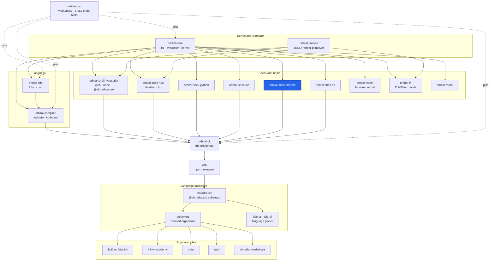

<div align="center">

# orbital-shell-android

**The native Android shell: generates a Gradle project (Jetpack Compose) from a compiled Orbital program.**

[](https://github.com/almadar-io/orbital-shell-android/actions/workflows/ci.yml) [](LICENSE)

</div>

The Android shell turns a compiled Orbital program into a Jetpack Compose app project. It carries the Android project template and the generated Compose renderer pack, and bundles the Almadar kernel and canvas as a native library.

## Where this fits



| Upstream (this repo depends on) | Downstream (depends on this repo) |
|---|---|
| [orbital-core](https://github.com/almadar-io/orbital-core): IR, evaluator and kernel (`orbital-core-base`, `orbital-core-eval`) | [orbital-cli](https://github.com/almadar-io/orbital-cli): the `orb` binary, which runs this shell as `orb-shell-android` for `orb compile --shell android` |
| [orbital-canvas](https://github.com/almadar-io/orbital-canvas): 2D/3D render primitives |  |
| [orbital-ffi](https://github.com/almadar-io/orbital-ffi): the C ABI library the generated app loads |  |

## Quick start

Build the kernel library once from the `orbital-rust` workspace (needs `cargo-ndk` and `ANDROID_NDK_HOME`), then generate and build the app:

```bash
make android-lib        # in orbital-rust: builds liborbital_ffi.so for arm64-v8a into target/jniLibs
ORBITAL_NATIVE_LIB_DIR=<orbital-rust>/target/jniLibs orb compile <program.orb> --shell android -o <out-dir>
cd <out-dir> && ./gradlew assembleDebug
```

Set `ANDROID_HOME` or `ANDROID_SDK_ROOT` before generating, or `local.properties` is not written. In `orbital-rust`, `make android-run ORB=<program.orb> OUT=<dir>` boots a device, compiles and installs.

## How `orb compile --shell android` uses it

`orb` runs the `orb-shell-android` program. It needs the resolved program and the installed `compose` renderer pack, copies `templates/android-shell` (Gradle wrapper, `app/`), generates the Kotlin sources and writes `local.properties` from the Android SDK location. When `ORBITAL_NATIVE_LIB_DIR` is set, it copies `<dir>/arm64-v8a/liborbital_ffi.so` into the project's `app/src/main/jniLibs/arm64-v8a/` and fails if the file is missing.

The generated app runs the same kernel as every other host, through `orbital-ffi` and its JNI bridge; `make android-lib` builds that library and checks that it exports the bridge symbols.

## Layout

| Path | Contents |
|---|---|
| `src/` | The crate: backend, pack, shell, `orb-shell-android` program |
| `templates/android-shell/` | Gradle project scaffold |
| `renderers/compose/` | Generated Compose renderer sources and pattern fixtures. Generated: fix the template or generator, not the output |
| `hosts/`, `runtime/` | Kotlin templates (`APIClient`, `OrbitalViewModel`, `AwaitRenders`, `EffectHandlers`) |
| `tests/` | Pack layout, renderer coverage, project native setup, kernel-bridge symbol coverage, `device-bench/` |

## Development

The crate reads the Almadar language data (patterns, operators, themes, vocabularies) from the installed npm packages, so install those first (this is the CI recipe):

```bash
npm install --no-save --no-package-lock @almadar/core@^10 @almadar/std@^16 @almadar/lolo-ar@^1 @almadar/lolo-sl@^1
cargo test
```

Open gaps are tracked in [Almadar_Gaps.md](Almadar_Gaps.md). Work on `main`; never create a feature branch.

CI also runs `node renderers/compose/scripts/check-pack.mjs` before `cargo test`.

## Docs

- [Orb documentation](https://orb.almadar.io/docs): the language, the `orb` CLI and how the pieces fit

## License

[Business Source License 1.1](LICENSE): free for non-commercial and evaluation use; converts to Apache-2.0 on the change date.
